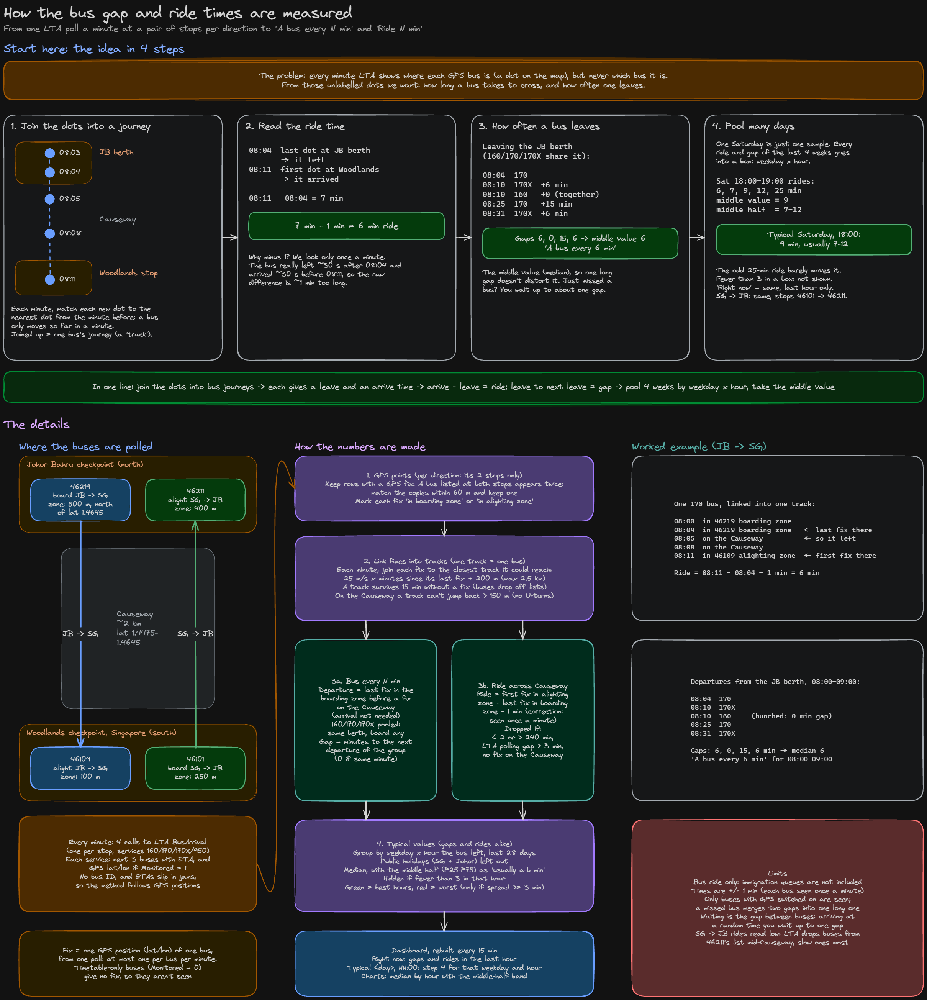

# Causeway Bus Times

[](https://github.com/Joel-Wong0794/woodlands-checkpoint-bus-study/actions/workflows/ci.yml)

How long the bus across the Johor–Singapore Causeway takes, and how often one leaves, by weekday and hour.

**Live page (phone-friendly):** https://storage.googleapis.com/woodlands-checkpoint-bus-dashboard/causeway-bus-times

## What it solves

Many people cross the Causeway between Johor Bahru and Woodlands by bus every day, for work, school or shopping. The questions they ask are simple:

- _When should I leave JB on a Saturday to get back to Singapore quickly?_
- _How long will I wait at the berth, and how long is the ride across?_

Nobody publishes the answers. LTA's live arrival times don't help much here: buses queue at the checkpoints, their ETAs keep slipping, and a bus at the JB berth shows as "due now" almost all the time. Google Maps gives a timetable estimate, not what actually happens.

This project **measures** it instead. It watches the buses every minute, works out how long each one really took to cross and how far apart they left, and builds a typical profile for each weekday and hour.

| Direction      | Board at                   | Alight at                  | Buses                                      |
| -------------- | -------------------------- | -------------------------- | ------------------------------------------ |
| JB → Singapore | 46219 JB Checkpoint        | 46109 Woodlands Checkpoint | 160 / 170 / 170X (same berth, pooled), 950 |
| Singapore → JB | 46101 Woodlands Checkpoint | 46211 JB Checkpoint        | Same                                       |

The page shows, per direction and bus:

- **Right now:** gap between buses and ride time over the last hour.
- **Typical <day>, <hour>:** the median over the last 4 weeks for that weekday and hour, with the usual range.
- **Charts by hour:** ride time and gap between buses, with the best (green) and worst (red) hours to travel.

It measures the **bus ride only**. Immigration queues before boarding and after getting off aren't in any data source used here.

## Data collection

Data collection is the part that runs non-stop in the background and records raw observations, so there's something to analyse later. Nothing is calculated at this stage: it only stores what LTA said, minute by minute.

- **Source:** [LTA DataMall](https://datamall.lta.gov.sg/) `BusArrival` API. For each stop it lists the next 3 buses of each service, with an ETA and, for buses with GPS on, their current position.
- **How often:** every minute, 24/7, one call per stop (4 stops).
- **What's kept:** each listed bus (service, ETA, GPS position, load, bus type), plus one row per call. That row records whether the call succeeded, so "no bus listed" can be told apart from "we didn't ask".
- **Where:** a SQLite database on a small Google Cloud VM. It grows by about 5 MB a day.

Collection started on 9 Oct 2026 (the SG → JB stops on 11 Oct 2026).

Because only raw data is stored, every result is recomputed from scratch. If a calculation rule changes, the whole history is simply rebuilt with the new rule.

## How the times are worked out



In short:

1. **Join the dots.** LTA gives bus positions but no bus ID. Each minute, every position is linked to the nearest position from the minute before, which turns the dots into one journey per bus.
2. **Ride time** = first time the bus is seen at the stop across the Causeway, minus the last time it's seen at the boarding berth, minus 1 minute. Buses are only seen once a minute, so the raw difference is about 1 minute too long.
3. **Gap between buses** = time from one departure to the next, counting any bus that uses the same berth.
4. **Typical values** = the median of all rides and gaps in the last 4 weeks for that weekday and hour, public holidays left out, and only shown if there are at least 3.

## Architecture

```
LTA DataMall ──every min──▶ collector.py ──▶ SQLite (raw polls)
                                                 │ every 15 min
                                                 ▼
                              dashboard.py + trips.py ──▶ dashboard.html
                                                 │
                                                 ▼
                        Cloud Storage (public bucket) ──▶ phone browser
```

| Part                | What it does                                                                                         |
| ------------------- | ---------------------------------------------------------------------------------------------------- |
| Google Cloud VM     | e2-micro, Always Free tier, Debian 12. `cron` runs everything                                        |
| `collector.py`      | Polls the 4 stops every minute and stores the raw rows                                               |
| `trips.py`          | Pure functions: GPS positions → bus tracks → rides and departures                                    |
| `calendar_flags.py` | Singapore and Johor public holidays (`holidays` package), so they stay out of the typical values     |
| `dashboard.py`      | Builds one static HTML page (Plotly charts) every 15 min, uploaded to a public bucket. No web server |
| Weekly backup       | Database copied to a private bucket every Sunday, kept for 30 days                                   |
| `quality_app.py`    | Local Streamlit app to inspect data quality from a database snapshot (not run on the VM)             |

## CI/CD

```
git push (main) ──▶ GitHub Actions: install deps, run the test suite
                          │ all tests pass
                          ▼
                    `deploy` branch moved to that commit
                          │ VM checks every 5 min (cron)
                          ▼
                    VM pulls `deploy` ──▶ next collector / dashboard run uses the new code
```

| Step | Where | What it does |
| --- | --- | --- |
| CI | [`.github/workflows/ci.yml`](.github/workflows/ci.yml) | Every push and pull request runs the tests on a fresh Ubuntu machine with Python 3.11 (same as the VM) |
| Release gate | Same workflow | Only if every test passes, the `deploy` branch is fast-forwarded to that commit. A failing commit never reaches the VM |
| CD | [`deploy/update.sh`](deploy/update.sh), cron on the VM | Fetches `deploy` every 5 min and pulls new commits. Reinstalls packages or the crontab only when those files changed. Logs each deploy |

The VM pulls instead of GitHub pushing to it: no SSH key stored in GitHub and no port opened to the internet. The VM only reads from the public repository.

## Known limitations

| Limitation                               | Effect                                                                                                      |
| ---------------------------------------- | ----------------------------------------------------------------------------------------------------------- |
| Bus ride only                            | Immigration queues aren't included                                                                          |
| Only buses with GPS switched on are seen | Some buses are missed; a missed bus merges two gaps into one longer gap                                     |
| Positions come once a minute             | Each ride and gap is accurate to about ±1 min                                                               |
| SG → JB rides read low                   | LTA drops a bus from 46211's list once its ETA passes, even mid-Causeway, so slow rides are lost more often |
| Typical values need weeks of data        | Each weekday × hour needs at least 3 rides; quiet hours stay blank until enough data builds up              |
| Holidays are rare                        | Public holidays are left out of the typical values; there aren't enough of them yet for their own profile   |
